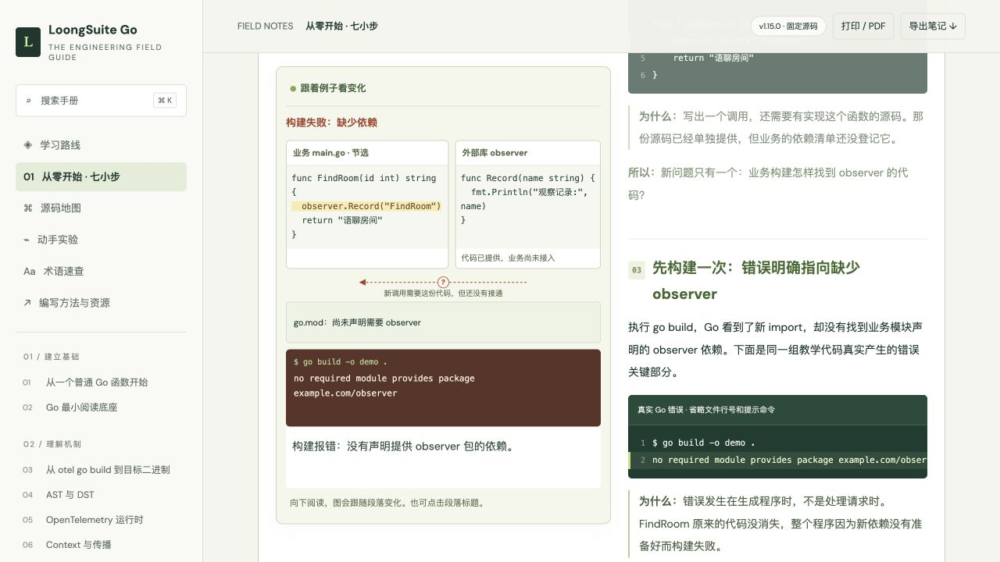

# LoongSuite Go Guide

从一个普通 Go 函数开始，逐步读懂 **LoongSuite Go 如何在构建时插入观察代码**，最终能阅读规则、修改 hook，并验证自己的改造。

这是一份独立编写的中文学习指南，包含随段落变化的动画、源码阅读地图、即时反馈练习和可以在本地运行的 Go 实验。面向第一次接触 Go 插桩、OpenTelemetry 或编译工具的读者。

> 源码讲解固定在 LoongSuite Go **v1.15.0**，提交 [`cac4009`](https://github.com/alibaba/loongsuite-go/tree/cac400935add57d8219122ba32857b8f55ac6eb1)。本指南不是上游官方文档，不能直接套用于任意新版本。

**在线阅读：<https://qinghua362330.github.io/loongsuite-go-guide/>**

[快速开始](#快速开始) · [对照官方文档](#对照官方文档阅读) · [学习路线](#学习路线) · [运行实验](#运行实验) · [修改指南](#修改指南) · [验证边界](#验证边界) · [下载发行包](https://github.com/qinghua362330/loongsuite-go-guide/releases)



## 这份指南怎样讲解

每页围绕一个具体问题，先看程序发生了什么，再解释名词与源码。图随阅读上下滚动切换，也可以点击段落标题重看该步。

例如“为什么插桩还要补依赖”这一页，用同一个小程序展示：

```text
原来的 FindRoom 可以运行
          ↓
增加 observer.Record 调用
          ↓
go build 报错：找不到 observer 依赖
          ↓
在原来的 go.mod 补 require 和本地 replace
          ↓
构建成功，但还没有执行记录
          ↓
运行程序：出现观察记录，原来的房间名仍然返回
```

页面提供修复配置的练习，每种选择都有具体反馈。这组代码另有真实 Go 编译实验核对；网页动画本身是教学推演，不会在浏览器中执行 Go。

## 快速开始

### 方式零：直接在线阅读

打开 [GitHub Pages 站点](https://qinghua362330.github.io/loongsuite-go-guide/)，无需下载或安装。站点由 `.github/workflows/pages.yml` 在每次推送 `main` 后检查并发布 `dist/`。

### 方式一：下载后阅读

到 [Releases](https://github.com/qinghua362330/loongsuite-go-guide/releases) 下载发行 ZIP，解压后打开 `dist/offline.html`。无需安装 Node.js、Go 或 LoongSuite。

离线页面内含脚本与样式，可以阅读正文和操作教学交互。源码外链、第三方参考资料需要联网；部分浏览器对本地文件存储有限制，遇到问题时使用下面的本地 HTTP 方式。

### 方式二：克隆并本地预览

需要 Git 和 Python 3：

```sh
git clone https://github.com/qinghua362330/loongsuite-go-guide.git
cd loongsuite-go-guide
python3 -m http.server 8767 --bind 127.0.0.1 --directory dist
```

打开 [从零开始：第 1 步](http://127.0.0.1:8767/#/start/1)。也可直接阅读 [补依赖实例](http://127.0.0.1:8767/#/start/6)。服务仅监听本机，按 `Ctrl+C` 停止。

网站直接使用 HTML、CSS 和 JavaScript，没有 npm 依赖，无需执行 `npm install`。学习进度与笔记保存在当前浏览器，可通过页面的“导出笔记”备份。

## 对照官方文档阅读

[LoongSuite Go 官方文档](https://alibaba.github.io/loongsuite-go/zh/) 说明怎样使用、怎样开发插件。本指南的“对照官方文档”页（[在线](https://qinghua362330.github.io/loongsuite-go-guide/#/official)）按官方侧栏的 20 页逐页给出：官方这页讲什么、初学者容易卡在哪里、在本指南中接着读哪些实例与源码，以及一道自测题。每页标明本指南是详细展开、部分覆盖，还是以官方为准。

核对日（2026-10-29）官方文档 `main` 与固定版本 v1.15.0 的 `docs/` 只差支持库表中一个链接写法。

## 学习路线

| 阶段 | 内容 | 学完要能回答 |
| --- | --- | --- |
| 从零开始 · 7 步 | 普通函数、包与模块、go.mod、构建与运行、规则与 hook、补依赖、Trace 与 Span | 工具多加一行调用，为什么还需要准备另一份代码？ |
| 分阶课程 · 13 章 | Go 阅读基础、构建流程、AST/DST、OTel、context、架构、规则、hook、运行时、兼容、调试与毕业项目 | 一条规则怎样变成程序运行时的观察动作？ |
| 源码地图 · 20 个节点 | CLI、Preprocess、依赖准备、规则匹配、toolexec、函数改写、trampoline、linkname、运行时上下文 | 每一步由哪个文件和函数完成？输入与输出是什么？ |
| 动手实验 · 7 组 | 标准库小程序 → 编译包装器 → 真实 hook → OTel 父子关系与传播 | 怎样用断言证明改动生效，原有结果仍正确？ |

当前内容有 **40 个随文实例、42 种情况、176 段图文步骤**。这些是教学内容覆盖量，不代表完成了全部生产兼容性测试。

建议第一次学习按 7 个入门步骤顺序阅读，能解释自己的练习结果后再进入源码页。已经了解 Go 模块与构建的读者，可以从“源码地图”进入。

## 运行实验

需要 **Go 1.25 或更高版本**。各实验是独立模块，首次运行带第三方依赖的实验时需要下载 Go 模块。

从仓库根目录执行一个实验：

```sh
cd labs/00-start
go run .
```

| 实验 | 观察什么 | 额外要求 |
| --- | --- | --- |
| `00-start` | 普通函数与手动增加的观察动作 | Go 标准库 |
| `01-context` | 显式 context、新协程和预创建 worker 的交接 | Go 标准库 |
| `02-ast` | 用语法结构给目标函数插入动作 | Go 标准库 |
| `03-toolexec` | 让真实编译器与链接器经过包装器 | Go 标准库 |
| `04-custom-hook` | JSON 规则与真实 OnEnter / OnExit | 插桩部分需要固定版本的 LoongSuite 工具 |
| `05-otel` | 真正的 TraceID、父 Span、采样与内存 exporter | 下载 OTel Go 模块；不需要 Collector |
| `06-propagation` | W3C、B3 单头/多头、冲突与旧头清理 | 下载 OTel propagator 模块；不连接真实网关 |

运行常规实验：

```sh
sh labs/run-all.sh
```

这条命令会运行 `04-custom-hook` 的普通版本，并明确跳过需要上游工具的插桩部分。要验证真正的 LoongSuite hook，先按 [实验说明](labs/README.md#04-custom-hook) 构建固定版本工具，再从仓库根目录执行：

```sh
OTEL_TOOL=/absolute/path/to/otel sh labs/run-all.sh --with-otel
```

真实 hook 运行可能尝试向本机 OTLP Collector 导出数据。没有 Collector 时出现连接失败，并不能证明远端上报成功；本实验检查 hook 执行和原业务结果。详细操作与预期输出见 [labs/README.md](labs/README.md)。

## 修改指南

生成与检查需要 **Node.js 22+、Python 3 和 Go 1.25+**。没有前端依赖安装步骤。

```sh
# 修改章节、图解或实验后，重新生成离线页面、正文和实验 ZIP
npm run build

# 检查内容、模块语法、图文映射、滚动逻辑、练习状态和真实 Go 依赖实验
npm run check

# 预览生成的网站
npm run serve
```

也可直接运行对应脚本：

```sh
node scripts/prepare.mjs
python3 scripts/package-labs.py
node scripts/check.mjs
```

生成使用已提交的 `content/source-snapshot.json`，**不需要下载完整上游源码或准备 research 缓存**。如要修改固定版本，请同时核对摘录、源码链接、章节解释和实验，不能只替换版本字符串。

## 项目结构

```text
.
├── dist/                         # 可直接托管的网站；也包含可编辑的前端源码
│   ├── index.html                # 模块版入口
│   ├── offline.html              # 生成的单文件离线版
│   ├── zero.js                   # 七步入门内容
│   ├── chapters.js               # 十三章课程与测验
│   ├── source-lessons.js         # 二十个源码节点讲解
│   ├── official-docs.js          # 对照官方文档的 20 页阅读路径
│   ├── *-demos.js                # 实例、逐段代码和因果说明
│   ├── motion-map.js             # 每一步的图解对象和动作
│   ├── motion-scene.js           # 通用 SVG 图解
│   ├── dependency-lesson.js      # 补依赖实例的专用动画与修复练习
│   ├── lesson-demo.js            # 图文渲染与滚动同步
│   ├── app.js / style.css        # 页面、搜索、笔记和布局
│   └── assets/                   # 实验 ZIP 与上游许可
├── content/                      # 固定源码摘录、实验记录和教学审查
├── labs/                         # 七组可运行的 Go 实验
├── scripts/                      # 生成、打包和验证脚本
├── docs/images/                  # README 预览图
├── VERIFICATION.md               # 历次验证记录与局限
├── NOTICE                        # 来源与归属说明
└── LICENSE                       # Apache-2.0
```

`dist/` 同时存放可编辑源码和生成文件，本仓库有意提交它，以便下载后直接阅读。修改内容源文件后，提交时一并更新生成的 `offline.html`、`guide.md` 等文件。

## 验证边界

- `npm run check` 会实际构建“缺少 observer → 补齐依赖”的隔离 Go 小程序；其他页面动画属于教学模型。
- 页面中的实验结果来自已记录的本地执行，打开页面不会重新运行那些实验。历史证据见 [VERIFICATION.md](VERIFICATION.md)，本轮教学审查见 [content/teaching-review.md](content/teaching-review.md)。
- 示例项目、服务名、请求编号和固定 Trace ID 都用于教学，不包含真实业务实现、配置、凭据或请求日志。
- context、传播和去重实验不能替代真实服务的集成测试；不承诺覆盖所有库版本、网关、消息队列、协程池或运行时 ABI。
- 已检查电脑与手机尺寸的浏览器布局；真实手机设备、不同浏览器及直接打开本地文件仍可能有差异。

## 参与改进

发现解释不清楚、图文不一致或源码定位错误，欢迎 [提交 Issue](https://github.com/qinghua362330/loongsuite-go-guide/issues)。请附上页面路由、当前步骤、你预期看到的结果和实际结果；不要贴业务凭据或真实日志。

修改内容时，先说明读者要解决的问题，再提供最小例子和可观察结果；新增动图应与段落里的代码、名称和执行顺序一致。提交前运行生成与检查命令。详见 [CONTRIBUTING.md](CONTRIBUTING.md)。

## 来源与许可

本仓库采用 [Apache-2.0](LICENSE)。LoongSuite 源码摘录保留上游版权和许可，归属说明见 [NOTICE](NOTICE) 与 [上游许可证副本](dist/assets/LOONGSUITE-LICENSE.txt)。第三方模块与外部参考资料遵循各自许可证。

主要参考：

- [LoongSuite Go](https://github.com/alibaba/loongsuite-go)：固定版本源码与规则实现。
- [Go 官方文档](https://go.dev/doc/)：模块、构建、语法树与 context。
- [OpenTelemetry Go](https://github.com/open-telemetry/opentelemetry-go)：Span、SDK 与传播器。

教学编写方法与更多资源见 [RESOURCES.md](RESOURCES.md) 和 [编写资源说明](dist/guide-authoring-resources.md)。
